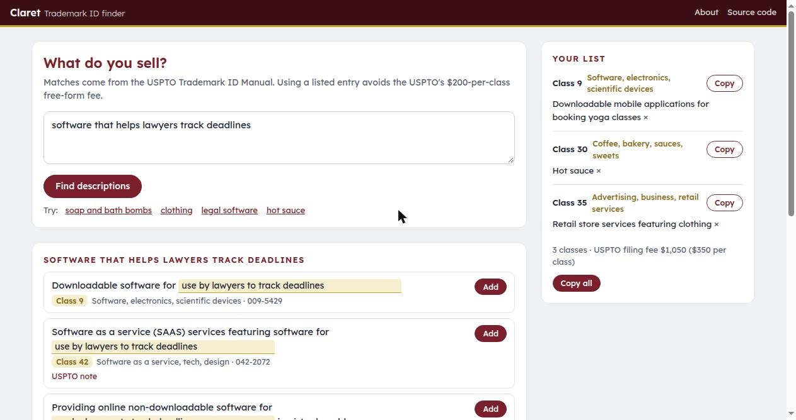

# Trademark ID Finder (Claret): find the USPTO-approved wording for what you sell

Claret is a one-page search of the USPTO Trademark ID Manual. You type what you sell in your own words ("scented candles", "an app for booking yoga classes", "online clothing store") and it lists the closest pre-approved goods and services descriptions, with their classes. You add the ones that fit to a list, fill in any `{blanks}`, and copy the identification for each class into the application.

Choosing ID Manual wording instead of writing your own description avoids the USPTO's $200-per-class free-form fee and many examiner objections to the identification.



**Try it:** open `index.html` from any web server (`python3 -m http.server`).

## How it matches
- A small sentence-embedding model ([all-MiniLM-L6-v2](https://huggingface.co/sentence-transformers/all-MiniLM-L6-v2), through [transformers.js](https://huggingface.co/docs/transformers.js)) turns the query into a vector in the browser. The model (about 25 MB) is downloaded once and cached.
- Every ID Manual entry has a pre-computed vector, stored as one sign bit per dimension (`data/vectors.bin`, 48 bytes per entry, 3.3 MB). The query is scored against all 68,000+ entries in a few milliseconds, then blended with a plain word match.
- Apps, software and stores get the ID Manual's fill-in entries first ("Downloadable mobile applications for {…}", "Software as a service (SAAS) services featuring software for {…}", "Retail store services featuring {…}"), with the blank filled from the query.
- If the model cannot load, it falls back to the word match.

Nothing you type leaves your browser. The list you build is kept in the browser's local storage.

## Updating the data
Download the full manual from the [ID Manual](https://idm-tmng.uspto.gov/id-master-list-public.html) (Download → Excel; the file is an HTML table), then:

```
pip install sentence-transformers numpy
python3 tools/build_data.py idmanual.xls data/
```

Deleted entries, class 000 entries (not selectable when filing) and the certification classes A and B are left out.

## What it is not
It is not legal advice and does not check whether a description fits your actual goods, or whether the mark is available. The examining attorney has the final word on every identification.

## Name
Claret is the deep red of Bordeaux wine, a name the English gave it in the Middle Ages to tell it apart from the rest.

MIT License. ID Manual entries are USPTO data (public domain).
